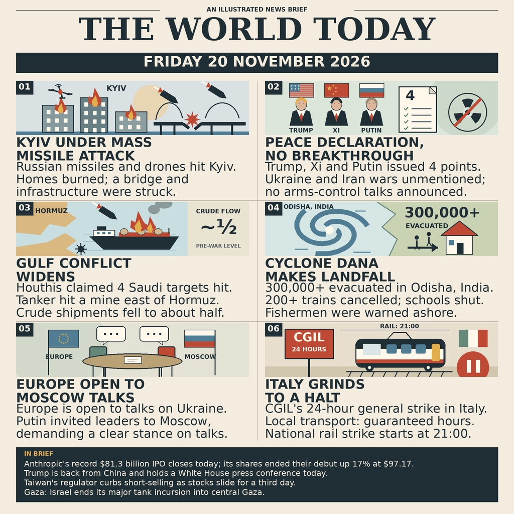

[](https://make.fun/bounty/news-image-20261120)
[](https://make.fun/bounty/news-image-20261120)
[](https://make.fun/bounty/news-image-20261120)

# The World Today — Friday 20 November 2026

A newspaper front-page infographic for the `news-image-20261120` bounty. The 1024 × 1024 PNG uses warm paper, dark ink, original flat geometric illustrations, a prominent date, six story panels, and four footer briefs. Headlines and concise captions accompany each picture. All news comes exclusively from the verified facts supplied in the bounty request; the program adds no reporting, speculation, photographs, or external assets.



## The six stories

1. **Kyiv under mass missile attack.** Overnight into Friday, Russia launched a large missile and drone attack on Ukraine. Explosions began around 01:25 in Kyiv; residential buildings burned in Obolonskyi, Podilskyi and Holosiivskyi, and an infrastructure facility and a bridge were hit. The attack followed Putin's promise of a more painful response to Ukraine's strikes on the Crimean Bridge. The illustration shows missiles, a drone, burning buildings and a struck bridge.
2. **Peace declaration, no breakthrough.** Trump, Xi Jinping and Putin published a four-point declaration after their first trilateral meeting in Shenzhen: nuclear war cannot be won and must never be fought, UN reform, more refined petroleum supply, and limits on the International Criminal Court. It said nothing about the Ukraine or Iran wars and announced no arms-control talks. Three leaders, a four-point document and a crossed nuclear symbol illustrate the story.
3. **Gulf conflict widens.** The Houthis claimed drone and missile strikes on four Saudi targets. A tanker caught fire after hitting a mine east of the Strait of Hormuz; crude shipments through the strait fell to about half their pre-war level. A burning tanker, mine, shipping channel and half-flow callout depict these facts.
4. **Cyclone Dana makes landfall.** Landfall began early Friday on India's Odisha coast. More than 300,000 people were evacuated and over 200 trains cancelled; schools closed and fishermen were warned ashore. The picture shows a cyclone, coastline, shelter and evacuation arrow.
5. **Europe open to Moscow talks.** European leaders said they were ready for talks with Russia on ending the war in Ukraine. Putin invited European leaders to Moscow and demanded a clear position on negotiations. Facing flags, dialogue symbols and empty chairs depict the invitation to talks.
6. **Italy grinds to a halt.** CGIL's 24-hour general strike stopped work across Italy on Friday. Local transport ran only in guaranteed hours; a national rail strike starts at 21:00. An Italian tricolor, union placard, train and pause symbol depict the disruption.

The footer covers Anthropic's record $81.3 billion IPO closing today and its debut shares ending up 17% at $97.17; Trump's return from China and White House press conference today; Taiwan's regulator curbing short-selling as stocks slide for a third day; and Israel ending its major tank incursion into central Gaza.

## Run offline

```sh
node main.ts
```

The entrypoint uses plain Node 22 CommonJS and only the standard library. It creates `/output` and copies the bundled image to `/output/entry.png`. No package installation, Python, fonts, or network access is needed at runtime. Every run copies identical bytes.

Choose a different output directory with the environment variable:

```sh
MAKEFUN_OUTPUT_DIR=/tmp/news-image-output node main.ts
cmp entry.png /tmp/news-image-output/entry.png
```

## Re-render offline

Rendering requires Python 3, Pillow, and the installed DejaVu fonts at `/usr/share/fonts/truetype/dejavu/`. The renderer draws at 2048 × 2048, downsamples once with Lanczos to 1024 × 1024, and saves an optimized RGB PNG no larger than 1 MiB. It uses fixed geometry and text, with no randomness, clock reads, or network access.

```sh
python3 render.py
```

The default destination is the repository directory. Supply a directory to render independent verification copies:

```sh
python3 render.py out1
python3 render.py out2
sha256sum out1/entry.png out2/entry.png
cmp out1/entry.png out2/entry.png
cp out1/entry.png entry.png
```

`out1/` and `out2/` are ignored by Git. The bundled image is committed along with its renderer and entrypoint.

MIT licensed; see [LICENSE](LICENSE).
